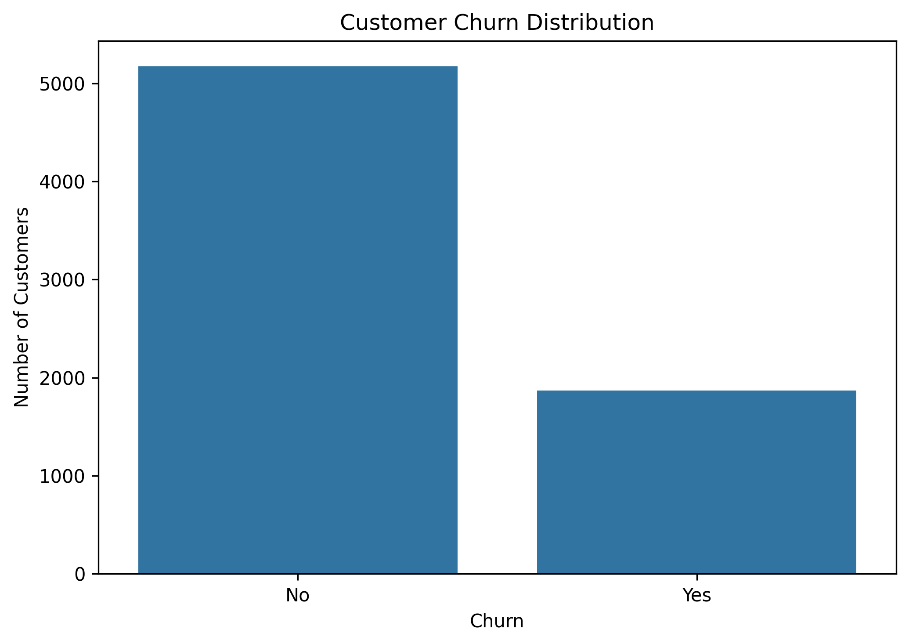
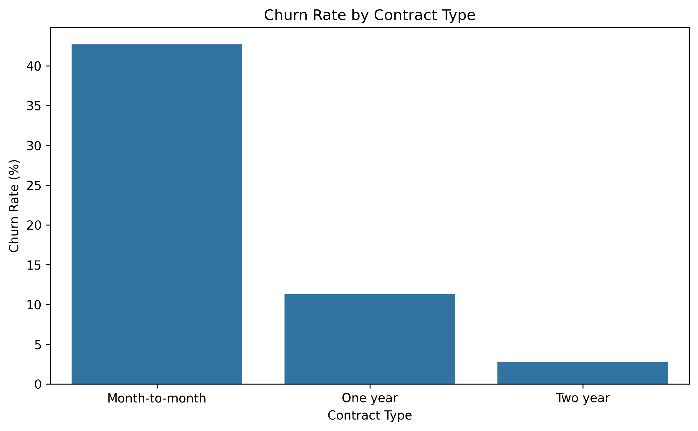
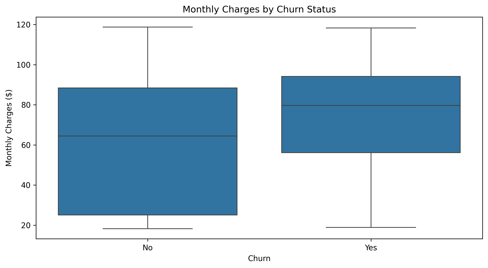
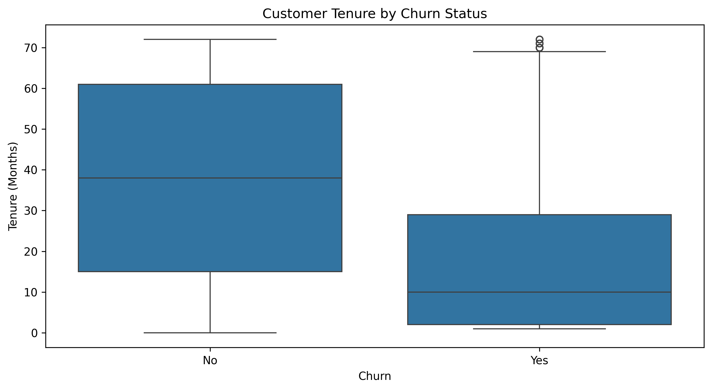
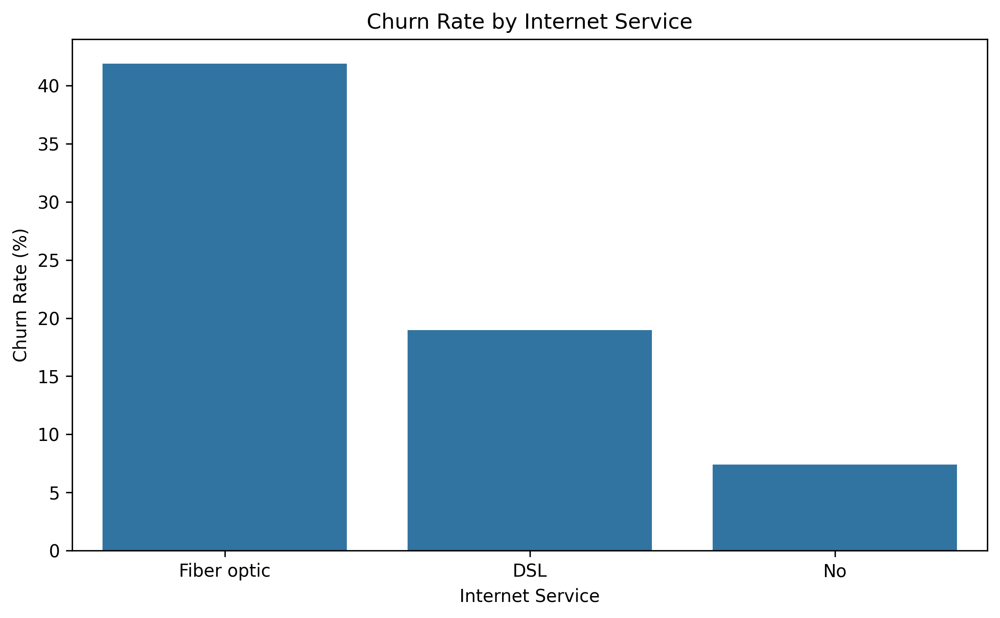

# Customer Churn Analysis

## Project Overview

This project analyzes customer churn data from a telecommunications company to identify the main factors associated with customers leaving the service.

The goal is to use Python and exploratory data analysis to better understand customer behavior and uncover patterns that may help improve customer retention.

## Dataset

The dataset contains 7,043 customer records with information including:

- Customer demographics
- Tenure
- Phone service
- Internet service
- Online security
- Online backup
- Device protection
- Tech support
- Streaming services
- Contract type
- Paperless billing
- Payment method
- Monthly charges
- Total charges
- Churn status

## Tools Used

- Python
- Pandas
- NumPy
- Matplotlib
- Seaborn
- Jupyter Notebook

## Key Metrics

- Total Customers: **7,043**
- Customers Who Churned: **1,869**
- Customers Who Stayed: **5,174**
- Overall Churn Rate: **26.54%**

## Key Findings

- Customers on **month-to-month contracts** had the highest churn rate at approximately **42.71%**.
- Customers on **one-year contracts** had a churn rate of approximately **11.27%**.
- Customers on **two-year contracts** had the lowest churn rate at approximately **2.83%**.
- Customers who churned paid higher monthly charges on average (**$74.44**) compared with customers who stayed (**$61.27**).
- Customers who churned had a shorter average tenure (**18.0 months**) compared with customers who stayed (**37.6 months**).
- Customers using **Fiber optic** internet service had the highest churn rate at approximately **41.89%**.
- Customers using **DSL** had a churn rate of approximately **18.96%**.
- Customers with no internet service had the lowest churn rate at approximately **7.40%**.

## Visualizations

### Customer Churn Distribution



### Churn Rate by Contract Type



### Monthly Charges by Churn Status



### Customer Tenure by Churn Status



### Churn Rate by Internet Service



## Business Recommendations

- Encourage month-to-month customers to move to longer-term contracts through incentives or loyalty offers.
- Focus retention efforts on newer customers, particularly during their first two years.
- Review pricing and service value for customers with higher monthly charges.
- Investigate the reasons behind the high churn rate among Fiber optic customers.
- Use targeted retention campaigns for customer groups with a higher likelihood of churn.

## Project Structure

```text
customer-churn-analysis/
│
├── data/
│   └── WA_Fn-UseC_-Telco-Customer-Churn.csv
│
├── notebooks/
│   └── customer_churn_analysis.ipynb
│
├── images/
│   ├── churn_distribution.png
│   ├── churn_by_contract.png
│   ├── monthly_charges_by_churn.png
│   ├── tenure_by_churn.png
│   └── churn_by_internet_service.png
│
├── README.md
├── requirements.txt
└── .gitignore
```

## How to Run

1. Clone this repository.

2. Create a Python virtual environment:

```bash
python -m venv .venv
```

3. Activate the virtual environment.

Windows PowerShell:

```powershell
.\.venv\Scripts\Activate.ps1
```

macOS/Linux:

```bash
source .venv/bin/activate
```

4. Install the required packages:

```bash
pip install -r requirements.txt
```

5. Open the notebook:

```text
notebooks/customer_churn_analysis.ipynb
```

6. Run the notebook cells from top to bottom.

## Skills Demonstrated

- Data cleaning
- Exploratory data analysis
- Missing-value handling
- Customer churn analysis
- KPI calculation
- Data visualization
- Customer segmentation
- Business insight generation